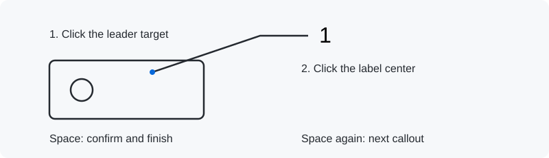

# PatentLabel

[English](README.md) | [简体中文](docs/README.zh-CN.md)

Two-click reference callouts for patent drawings in AutoCAD. Pick the leader target, pick the label position, then accept or type a label. PatentLabel previews the full leader, suggests the next identifier and keeps each callout as an ordinary block with a `NUMBER` attribute.

See two-click placement and automatic numbering in the [33-second AutoCAD demo (MP4)](docs/patent-label-demo.mp4).



## Download and install

Get a ZIP for your exact AutoCAD year and language from [Releases](https://github.com/numb-ys/patent-label/releases). Version 0.3.1 includes English and Chinese packages for all three supported years. English labels use Arial from your Windows installation.

1. Extract the entire ZIP.
2. Open the matching AutoCAD version and a drawing. Finish any active command.
3. Run `Install.cmd` for English packages, or the year-specific installer in the Chinese package.
4. Save your work and restart AutoCAD. Type `BH` to start.

The plug-in automatically loads at startup and in newly opened drawings for the current Windows user and AutoCAD profile. There is no per-drawing APPLOAD step. Installation adds only its exact plug-in folder to trusted paths and enables the startup-loading bit; it preserves unrelated settings and `SECURELOAD`. Files and backups are retained on uninstall.

Read the [English user guide](docs/USER_GUIDE_EN.md) or the [PDF manual](docs/USER_GUIDE_EN.pdf).

## Workflow

1. Type `BH` and press Enter.
2. Click the point on the part that the leader identifies.
3. Move the cursor to preview the whole leader and label. Click the label center.
4. The first label defaults to `1`. Press Space/Enter to accept it, or type a replacement. The command ends.
5. Press Space again to repeat `BH`, retaining the next suggested label.

The first Space confirms the current callout; the second is AutoCAD's normal command repeat. If another command runs in between, type `BH` again.

Labels accept 1-32 ASCII letters/digits, including `123`, `A`, `a`, `A01` and `12A`. Suggestions preserve leading zeros and prefixes: `001 -> 002`, `A99 -> A100`, `Z -> AA`. No drawing-wide duplicate detection or collision avoidance is implemented.

| Command | Purpose |
| --- | --- |
| `BH` | Create one callout with a two-segment leader |
| `BHSZ` | Set height, landing length, gap, confirmation key and weight |
| `BHXG` | Edit a label at the command line and recalculate the leader gap |
| `BHYD` | Move the label with a full leader preview, keeping the target fixed |
| `BHJC` | Apply the edition's font and Bold/Regular weight to selected callouts |
| `BHVER` | English editions: show version, preview-module status and font lookup |
| `BHHELP` | Show help |

English defaults to **Arial Regular**; Chinese defaults to **SimHei Regular**. Editing an existing callout preserves its current font unless you explicitly restyle it. Copied callouts are edited independently. Double-click uses AutoCAD's own attribute editor. Custom inline/double-click interception was removed after crash reports.

Move the `NUMBER` attribute grip to reposition just the label. The leader reconnects when the native command finishes, keeping the point on the part fixed. Native attribute text edits also recalculate the gap. Use `BHYD` for a live preview of the whole leader while moving. Moving the entire block still moves the entire callout. Existing PatentLabel blocks gain this behavior when the updated managed module is loaded; exploded geometry is not linked.

## Compatibility and verification

These are Windows **full AutoCAD** plug-ins. LT, macOS, ZWCAD, GstarCAD and unlisted releases are not supported by the supplied DLLs.

| AutoCAD | Managed target | Architecture | Verification boundary |
| --- | --- | --- | --- |
| 2014 | .NET Framework 4.0, supported 19.0 API baseline | AnyCPU, 32/64-bit target | Compiled; actual 2014 desktop testing required |
| 2019 | .NET Framework 4.7, 23.0 API | AnyCPU, 32/64-bit target | Compiled; actual 2019 desktop testing required |
| 2026 | .NET 8, 25.1 API | x64 | Core Console regression/interop checks; desktop testing required |

Automated checks use isolated Core Console settings and temporary drawing copies. They cover geometry, label defaults/increments, native Space repetition, fonts, preview objects, edits, copies, undo, UCS and save/reopen behavior. They do not automate mouse interaction or demonstrate that every native CAD crash has been eliminated. An English Windows/AutoCAD desktop still needs verification.

Use only one language edition per AutoCAD year. Installing another edition updates the same owned bundle; restart before use. Do not NETLOAD both DLLs into one process.

## Build from source

Install Python 3.10+ and a .NET 8+ SDK on Windows. AutoCAD itself is required for native integration testing, not for the NuGet-based 2019/2026 builds.

```powershell
python scripts/package_english.py --year 2019
python scripts/package_english.py --year 2026
```

The scripts generate ASCII English LSP/C# sources, build against pinned official Autodesk reference packages and place installable ZIPs in `dist/`. SDK DLLs, fonts and drawing files are not bundled.

For 2014, supply `AcCoreMgd.dll` and `AcDbMgd.dll` from your separately obtained official ObjectARX 2013/2014 SDK:

```powershell
python scripts/package_english.py --year 2014 --sdk2014 C:\SDK\ObjectARX2013\inc
```

The original Chinese sources and packaging scripts remain in `src/`, `legacy/` and `scripts/legacy/`. See [BUILDING.md](docs/BUILDING.md) for the file layout, native checks and documentation generation.

## Contribute

Read [CONTRIBUTING.md](CONTRIBUTING.md). Reports from real AutoCAD 2014/2019 installations and English Windows systems are particularly useful. Include `BHVER` output, your exact CAD version/update, steps and error text. Avoid sharing confidential drawings.

## License

[MIT](LICENSE), copyright 2026 numb-ys. AutoCAD and third-party components retain their own terms; see [THIRD_PARTY_NOTICES.md](THIRD_PARTY_NOTICES.md). This project is independent of Autodesk.
